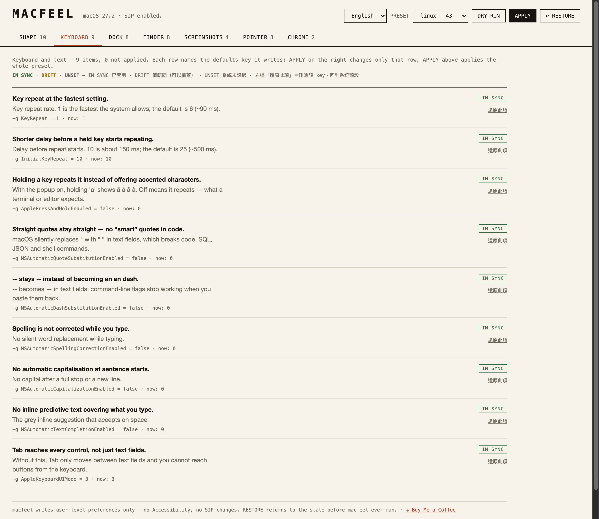

# macfeel

**Make macOS feel like Linux — reversible, auditable, no SIP changes.**

macOS is a good Unix with a UI that fights you: 16 pt window corners, animations between you and every keystroke, a mouse that accelerates, a Dock that never leaves. `macfeel` is a single dependency-free CLI that turns those off — and can put every one of them back.

```bash
git clone https://github.com/Kinfxhk/macfeel.git && cd macfeel
./install.sh
macfeel apply linux --dry-run   # see the 46 changes
macfeel apply linux             # snapshot first, then write
macfeel restore                 # back to exactly how it was
```

**[☕ Buy Me a Coffee](https://buymeacoffee.com/kinfxhk)** · MIT · macOS 13+ (tested on macOS 27.2)

---

## GUI

```bash
macfeel ui          # opens http://127.0.0.1:8765 — local only, no network
```



One tab per area — **Shape / Keyboard / Dock / Finder / Screenshots / Pointer / Chrome** — and every row answers three questions in place: what it does (in Chinese), which `defaults` key it writes, and whether your Mac currently matches.

- **APPLY** (top) applies a whole preset; **DRY RUN** prints it without writing.
- Rows that need a restart carry a tag: *restart apps to see this*, *takes effect after logout*, *Dock restarted*.
- **Each row is a switch**: ON writes that key, OFF deletes it so macOS falls back to its own default. The badge under the switch says why it is off — `DRIFT` (a different value is set) or `UNSET` (macOS never set it).
- **RESTORE** returns to the oldest snapshot — the state before macfeel ever ran.

The panel is a single HTML file served by `python3` from the repo. No Electron, no build step, no dependencies, and it binds `127.0.0.1` only.

## Languages

The CLI and the panel ship in **English, 繁體中文 and 简体中文**.

- The CLI follows `MACFEEL_LANG`, then `AppleLocale` (`zh-Hans` → 简体, any other `zh` → 繁體, else English).
- `macfeel ui` starts in the same language; the selector in the top bar switches the panel live and remembers the choice.
- Every tweak carries a one-line description and a longer explanation in all three languages — see [`lib/i18n/`](lib/i18n).

```bash
MACFEEL_LANG=zh_Hans macfeel status linux
MACFEEL_LANG=en macfeel apply linux --dry-run
```

Adding a language is one more column in `lib/i18n/{desc,notes,ui}.tsv`; CI fails if any tweak or any key used by the panel is missing a translation.

## Why another defaults script

The internet already has 50-line `defaults write` gists. They have two problems: you cannot undo them, and you cannot tell what they touched. macfeel is built around three rules:

1. **Nothing is written without a snapshot.** Every run exports the domains it is about to touch to `~/.macfeel/snapshots/<timestamp>/`.
2. **`restore` is per-key, not per-domain.** Importing an old whole domain would silently roll back preferences other apps wrote since. macfeel restores only the keys it owns — writing the saved value, or deleting the key if it did not exist before.
3. **`--dry-run` is the default mental model.** Nothing runs blind; every tweak carries a description and a restart hint.

## Profiles

| Profile | What it is for | Tweaks |
|---|---|---|
| `linux` (default) | the full "stop wasting my time" set | 46 |
| `minimal` | just shape and speed: square corners, no animations, fast key repeat | 5 |
| `chrome` | hides the menu bar and the Dock on top of `linux` | 4 |

```bash
macfeel list linux      # what it would change
macfeel status linux    # current vs wanted, per key
macfeel apply chrome    # menu bar + Dock out of the way
```

## Speed scale · 速度刻度

Most of the animation and typing tweaks are really one dial: how fast the interface feels. `macfeel speed` grades that dial into five levels, so "make it faster" is a number instead of a hunt through seven keys.

| Level | Feel | Window resize | Dock hide | Mission Control | Key repeat |
|---|---|---|---|---|---|
| `1` | 瞬速 instant | 0.001 s | 0 s | 0.05 s | ≈15 ms |
| `2` | 快 fast | 0.05 s | 0.1 s | 0.1 s | ≈15 ms |
| `3` | 平衡 balanced | 0.1 s | 0.15 s | 0.15 s | ≈30 ms |
| `4` | 順滑 smooth | 0.15 s | 0.25 s | 0.2 s | ≈60 ms |
| `5` | 原生 stock | 0.2 s | 0.5 s | 0.25 s | ≈90 ms |

```bash
macfeel speed              # which level this Mac is at right now
macfeel speed 2 --dry-run  # show the diff, write nothing
macfeel speed 2            # snapshot, then write
```

A level only touches the seven keys it owns, and every write goes through the same snapshot, per-key restore and read-back verification as a profile — so `macfeel restore` still undoes it. Window keys need the app relaunched; Dock keys restart the Dock.


## What it changes (43 keys, all `defaults`-only)

**Shape** — window corner radius (`NSConvolutionOverride1`, `0.1` = square, `4` = Catalina, `16` = Tahoe default), edge-to-edge sidebar, sidebar glass radius, window animations off, resize animation 0.001 s, save panels expanded, compact table rows.

**Keyboard** — `KeyRepeat 1` / `InitialKeyRepeat 10` (fastest sane), press-and-hold popup off so key repeat works in terminals, smart quotes / smart dashes / autocorrect / auto-capitalisation / inline completion all off (typing code stops fighting you), full keyboard access on so Tab reaches every control, double-clicking a title bar maximises instead of minimising.

**Dock** — auto-hide with zero delay, 0.15 s animation, `scale` minimise, no recent apps, no launch bounce, faster Mission Control, Spaces stay in a fixed order instead of re-sorting by recent use.

**Finder** — extensions, path bar, status bar, full path in title, list view by default, folders first, search starts in the current folder, Quick Look text is selectable, no extension-change warning, no `.DS_Store` on network or USB volumes.

**Screenshots** — no shadow, PNG, saved to `~/Pictures/Screenshots`, no floating thumbnail.

**Pointer** — natural scrolling off (Linux direction), mouse acceleration off (`com.apple.mouse.scaling -1`, takes effect after logout), tap-to-click on.

**Chrome (opt-in)** — menu bar auto-hide.

Full table with provenance: [`lib/tweaks.conf`](lib/tweaks.conf), the long explanations in [`lib/notes.conf`](lib/notes.conf), and sources in [`docs/SOURCES.md`](docs/SOURCES.md).

## Commands

```
macfeel list [profile]        show the tweaks a profile would change
macfeel status [profile]      current vs desired for every tweak
macfeel apply [profile]       snapshot, then write (default: linux)
macfeel apply --dry-run       print what would change, write nothing
macfeel restore [snapshot]    restore the oldest snapshot (or a named one)
macfeel ui [--port N]         open the local control panel
macfeel set <id> [--unset]    write or remove a single tweak
macfeel speed [1-5]          show or set the 5-level speed scale
macfeel snapshot              take a snapshot without changing anything
macfeel doctor                macOS version, SIP status, profile sizes
macfeel about                 version, licence, coffee
```

## What needs a restart

macfeel restarts Dock, Finder and the menu bar for you. Two things it cannot do for you, and both
are labelled in `status` and in the panel:

| Needs | Tweaks |
|---|---|
| **Quit and reopen the app** | `win.corner`, `win.sidebar-float`, `win.sidebar-radius`, `win.no-animations`, `win.resize-time`, `win.save-expanded`, `win.save-expanded2`, `win.tableView-compact` |
| **Log out and back in** | `ptr.linear-mouse` (`com.apple.mouse.scaling` is read at login, and the Tracking speed slider overwrites it) |

Everything else is live the moment `apply` returns.

## Safety

- **No Accessibility, no Input Monitoring, no Full Disk Access.** macfeel only writes user-level preferences.
- **SIP stays on.** Nothing here injects into WindowServer, Dock.app or any system binary.
- **No kernel extensions, no drivers, no login items.**
- Every value is a plain `defaults` key, so `defaults read <domain> <key>` always tells you the truth.
- `restore` picks the **oldest** snapshot by default — the state before macfeel ever ran — not the most recent one.

## What it will not do (on purpose)

| Want | Reality |
|---|---|
| Window shadows / borders | WindowServer private API. Needs injection — out of scope. |
| True 1:1 mouse curve that survives the slider | Needs an event tap (Accessibility). macfeel uses `com.apple.mouse.scaling -1` and says "log out". |
| Smooth wheel scrolling | Needs an event tap. Not a preference. |
| i3-style tiling | macOS 15+ tiles natively (`fn`+`ctrl`+arrows). Beyond that, a window manager needs Accessibility. |
| Moving windows between Spaces from the CLI | Needs a SIP-off scripting addition. |

macfeel is deliberately the *preferences* layer. It is the part that needs no trust.

## Uninstall

```bash
macfeel restore          # put every key back
rm -rf ~/dev/macfeel ~/.macfeel
```

## 中文簡介

macOS 嘅 UI 同 Unix 底子唔夾：圓角、動畫、滑鼠加速、Dock 長駐。`macfeel` 用一個無依賴 CLI 把呢啲全部關掉，而且**每一步都可以還原**：每次 apply 之前自動 snapshot，`restore` 只會還原 macfeel 自己改過嘅 key，唔會拖累其他 app 嘅設定。全程唔需要 Accessibility 權限、唔需要關 SIP、唔會裝任何驅動。

## License

MIT © KinFx · [☕ Buy Me a Coffee](https://buymeacoffee.com/kinfxhk)
